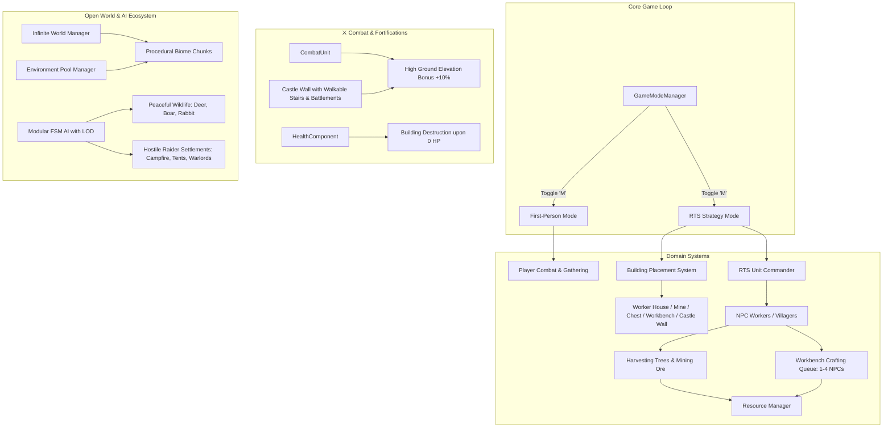
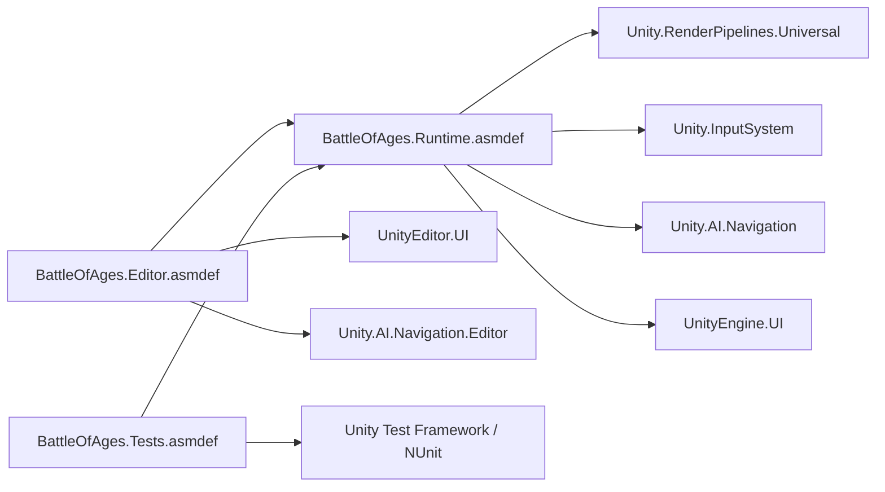

# 🏛️ Battle of Ages — Архітектурний Документ Проекту (Architecture Design Document)

> **Стандарт документації**: Enterprise-grade Game Architecture (рівень Senior / Lead Unity Architect).  
> **Версія проекту**: Unity 6 (`6000.3.6f1`) | **Render Pipeline**: URP (`17.3.0`) | **C#**: 9.0 (.NET Standard 2.1)

---

## 1. Концепція та Архітектурне Бачення (Executive Summary)

**Battle of Ages** — це гібридна гра відкритого світу, що безшовно поєднує два взаємопов'язані жанри:
1. **First-Person RPG / Survival**: гравець досліджує світ, збирає ресурси (деревина, руда різних рівнів), піднімається на замкові стіни для отримання переваги висоти (+10% урону), б'ється з дикими звірами та рейдерами, крафтить екіпірування на верстаку.
2. **RTS & Colony Management**: гравець перемикається в стратегічний режим карти, керує робітниками, розміщує споруди (будинки, склади, шахти, верстаки, замкові стіни зі сходами), призначає селян на видобуток і крафт, тримає оборону проти набігів ворожих таборів.

---

## 2. Модульна Архітектура та Assembly Definitions (.asmdef)

Проект розбитий на ізольовані збірки для прискорення інкрементальної компіляції та підтримки чистих кордонів залежностей:

### Структура модулів:
- **`BattleOfAges.Runtime`** (`Assets/Scripts/`): уся бізнес-логіка, фізика, UI, AI, процедурна генерація та математичні калькулятори.
- **`BattleOfAges.Editor`** (`Assets/Editor/`): інструменти редактора, генератори моделей, утиліти налаштування сцени.
- **`BattleOfAges.Tests`** (`Assets/Tests/EditMode/`): незалежний набір EditMode Unit-тестів для CI/CD та локальної верифікації.

---

## 3. Детальний Огляд Підсистем

### 3.1. Генерація Світу, Тварин та Ворожих Таборів (`BattleOfAges.World`, `Utils`)
- **`InfiniteWorldManager`**:
  - Відстежує позицію цілі (`Player` / `Camera`).
  - Підтримує активний радіус $7 \times 7$ чанків навколо спостерігача.
  - Реалізує когерентну Perlin-шумову карту висот з пласкою безпечною зоною спавну ($R \le 50\text{м}$).
- **`ProceduralBiomeChunk`**:
  - Генерує динамічні біоми (Степ, Хвойний Ліс, Пустеля, Сніжні Піки).
  - Спавнить диких тварин ([`AnimalModelBuilder`](file:///c:/Users/olesm/Battle_of_ages/Assets/Scripts/Utils/AnimalModelBuilder.cs)): олені, кабани, зайці.
  - На дистанціях $\ge 2$ чанки генерує ворожі табори розбійників ([`HostileCampBuilder`](file:///c:/Users/olesm/Battle_of_ages/Assets/Scripts/Utils/HostileCampBuilder.cs)): багаття, намети, барикади, прапори, загін рейдерів на чолі з ватажком.
- **`EnvironmentPoolManager`**:
  - Реалізує патерн **Object Pool** для мешів чанків, дерев (`ResourceNodeTree`) та камінців руди (`OrePebbleNode`), усуваючи фризи та виділення пам'яті (Zero-GC).

---

### 3.2. Модульний Штучний Інтелект (FSM) та AI LOD (`BattleOfAges.AI`)
Усі сутності AI успадковують базовий контролер `AIBaseController`, що реалізує скінченний автомат (FSM) та **AI LOD Throttling**:

| Дистанція до гравця | Частота оновлення AI | Призначення |
|---|---|---|
| $< 25\text{м}$ | **$20\text{ Hz}$** ($0.05\text{s}$) | Ближній бій, реакції в кадрі |
| $25\text{м} - 75\text{м}$ | **$5\text{ Hz}$** ($0.20\text{s}$) | Середня дистанція, переслідування |
| $75\text{м} - 150\text{м}$ | **$1\text{ Hz}$** ($1.00\text{s}$) | Патрулювання, фоновий рух |
| $> 150\text{м}$ | **$0.5\text{ Hz}$** ($2.00\text{s}$) | Глибокий фон |

#### Класи AI:
1. **`PeacefulAnimalAI`** (Олені, кабани, зайці):
   - Стани: `AnimalIdleState`, `AnimalWanderState`, `AnimalFleeState`.
   - Процедурна анімація: нахил голови при щипанні трави, галоп/стрибки при втечі від гравця та хижаків при дистанції $< 14\text{м}$.
2. **`HostileMobAI`** (Розбійники, гобліни, охоронці):
   - Стани: `MobPatrolState`, `MobChaseState`, `MobAttackState`, `MobRetreatState`.
   - Агро-радіус $18\text{м}$, пріоритет цілей: гравець $\rightarrow$ селяни $\rightarrow$ замкові стіни/споруди, тактичний відступ до табору при $\text{HP} \le 20\%$.
3. **`HostileSettlementLeader`**:
   - Керує загоном ворожих бійців.
   - Періодично організовує скоординований штурм бази гравця (`AssaultPlayerBase`).
   - При втратах загону $> 50\%$ віддає наказ на організований відступ (`TacticalRetreat`).

---

### 3.3. Бойова Система, Перевага Висоти та Стіни (`BattleOfAges.Combat`, `Building`)
- **Перевага висоти (High Ground Damage Bonus +10%)**:
  $$\text{If } Y_{\text{Attacker}} > Y_{\text{Target}} + 1.2\text{m} \implies \text{FinalDamage} = \text{Round}(\text{BaseDamage} \times 1.10)$$
- **Замкова стіна з підйомом ([`CastleWall`](file:///c:/Users/olesm/Battle_of_ages/Assets/Scripts/Building/BuildingNode.cs#L272))**:
  - Міцність: **$600\text{ HP}$**.
  - Внутрішній дерев'яний поміст ($y = 2.65\text{м}$) із захисними кам'яними бійницями.
  - Вбудовані сходи з пологим рамп-коллайдером для легкого забігання гравця та лучників нагору.
  - **Автоматичне руйнування при 0 HP**: споруда відстежує `HealthComponent.OnDeath` і миттєво знищується, усуваючи перешкоду.

---

### 3.4. Економіка, Крафт, Склад та Екіпірування (`BattleOfAges.Crafting`, `UI`, `Player`)
- **`ItemStatCalculator`**:
  - **Меч (Sword)**: $+20\% \times \text{Level}$ урону ($25.0 \rightarrow 30.0 \rightarrow 35.0 \rightarrow 40.0 \rightarrow 45.0 \rightarrow 50.0$).
  - **Броня (Armor)**: $10\% \times \text{Level}$ поглинання урону ($10\%, 20\%, 30\%, 40\%, 50\%$).
  - **Інструменти (Сокира/Кайло)**: $+25\% \times \text{Level}$ до швидкості видобутку.
  - **Формула зменшення урону бронею**:
    $$\text{EffectiveDamage} = \max\left(1, \; \text{RoundToInt}\left(\text{RawDamage} \times (1.0 - 0.10 \times \text{ArmorLevel})\right)\right)$$
- **`WorkbenchNode` & `WorkbenchUI`**:
  - Гарантоване відкриття через `WorkbenchUI.EnsureInstance()`.
  - Підтримка одночасної роботи **до 4 NPC-робітників** на одному верстаку з прискоренням швидкості ($0\text{x} \rightarrow 1.0\text{x} \rightarrow 1.75\text{x} \rightarrow 2.4\text{x} \rightarrow 3.0\text{x}$).
  - **📦 Склад готових виробів**: скрафчені предмети автоматично надходять на склад верстака.
  - **Екіпірування гравця**: миттєве застосування зброї, броні чи інструментів (підвищення урону, захисту, швидкості рубки/видобутку).
  - **Озброєння селян**: призначення зброї найближчому робітнику з перетворенням його на захисника-воїна (`Soldier` / `Armored_Guard`).

---

## 4. Патерни та Стандарти Оптимізації (Zero-GC)

1. **Жодних виділень пам'яті в `Update()` / `FixedUpdate()`**:
   - Усі фізичні виклики використовують статичні перед-алоковані буфери (`NonAlloc`).
2. **Параметри анімацій та шейдерів**:
   - Використання кешованих `Animator.StringToHash(...)` та `Shader.PropertyToID(...)`.
3. **Об'єктний пулінг**:
   - Динамічні сутності (дерева, камінці, чанки) повертаються до пулу через `EnvironmentPoolManager`.

---

## 5. Тестування (CI / EditMode Testing)

Усі формули, черги та інтелект ШІ покриті тестами у папці `Assets/Tests/EditMode/`:
- **`ItemScalingTests`**: перевірка точних формул $+20\% \times \text{Lvl}$ меча, $10\% \times \text{Lvl}$ броні, інструментів 1–5 рівнів.
- **`CraftingQueueTests`**: перевірка черги крафту, обмеження на 4 робітників, мультиплікаторів швидкості, скасування завдань.
- **`CombatDamageMathTests`**: перевірка прямого поглинання $10\%..50\%$ бронею, бонусу висоти (+10%), порогу 1 DMG та руйнування стін при 0 HP.
- **`SmartAITests`**: перевірка тактичного фланкування, відступу при низькому HP, сповіщення стада тварин та самозбереження селян.
- **`CraftedItemInteractionTests`**: перевірка складу верстака, екіпірування гравця та озброєння селян.
